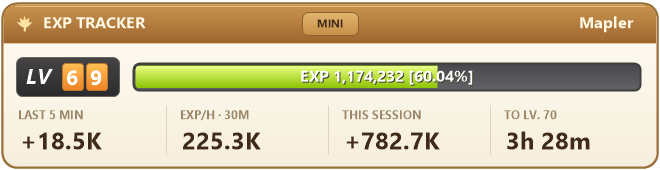

# MapleStory Classic EXP Tracker

An EXP-only overlay for Windows. Automatic screen reading, a classic cream-and-gold design, and a tiny mode that stays out of the way.

## Download and play

### [Download Viddy EXP for Windows](https://github.com/rednas-source/Maplestory-Classic-EXP-tracker/releases/latest/download/Viddy-EXP-Only-Windows-x64.zip)

**No coding, Git, Python, account or build step is needed.**

1. **Download** the Windows ZIP using the link above.
2. **Extract it:** right-click the downloaded ZIP → **Extract All…** → **Extract**.
3. Open the extracted folder and double-click **`Start Viddy EXP.cmd`**.
4. Open **MapleStory Classic** in **windowed or borderless fullscreen**. Keep the game's level and EXP amount/percentage visible.
5. Play normally. Tracking starts automatically after two consistent readings. **EXP/hour appears after 30 seconds of readable gameplay.**

**Keep the whole extracted folder together.** Do not run the launcher from inside the ZIP, and do not move the EXE away from its supporting files. You can create a desktop shortcut to `Start Viddy EXP.cmd` instead.

Prefer GitHub's green **Code → Download ZIP** button? That works too: extract the ZIP, open the `Maplestory-Classic-EXP-tracker-main` folder, and double-click the same **`Start Viddy EXP.cmd`** launcher. A ready-built app is included in the repository.

Windows may hide file extensions, so the launcher can appear simply as **Start Viddy EXP**. You can also open the `app` folder and double-click **ViddyExpOnly.exe** directly.

## What it looks like

**Full view**



**Tiny view**


The screenshots use example values. Your level and EXP appear when the game HUD is read.

## What's included

- Current level, EXP amount and percentage.
- EXP gained in the **last 5 minutes**.
- **EXP/hour**, based on up to 30 minutes of observed gameplay.
- Net EXP gained **this session**.
- Estimated time to your next level.
- Exact EXP required and remaining when you **hover** over the overlay.
- Full and tiny layouts, adjustable size and click-through mode.
- Stable on-screen numbers: the display refreshes every **12 seconds**.

**This app contains only EXP tracking and its display controls.** It has no bot, automated gameplay, key injection, potion or mesos tracking, map tools, profile builder, damage meter, or leaderboard.

## Move it, make it tiny, or pause it

**Right-click anywhere on the overlay** to open its menu. The icon in the Windows system tray has the same menu; click the **↑** beside the clock if the icon is hidden.

| What you want to do | How |
| --- | --- |
| Move the overlay | **Left-click and drag anywhere** on it, including in tiny mode |
| Use tiny mode / return to full view | Click **MINI / FULL** at the **top center**, or press **Ctrl+Alt+T**; also available in the right-click menu |
| Pause / resume reading | Right-click → **Pause tracking / Resume tracking**, or **Ctrl+Alt+P** |
| Click through the overlay | Right-click → **Click through**, or **Ctrl+Alt+L** |
| Unlock a click-through overlay | **Ctrl+Alt+L**, or use the **tray icon's menu** |
| Reset EXP and rates for a new session | Right-click → **New EXP session…** |
| Change its size | Right-click → **Size** → choose 75%, 100%, 125% or 150% |
| Change the name in the header | Right-click → **Header name…** |
| Bring an off-screen overlay back | Tray menu → **Move to primary screen** |
| See why it isn't reading | Right-click → **Reading status…** |
| Close the tracker | Right-click → **Exit Viddy EXP** |

If another program already uses a shortcut, use the right-click or tray menu. The shortcuts control this overlay only.

## If something isn't working

| Problem | What to do |
| --- | --- |
| The launcher says it cannot find the app | Extract the **whole ZIP**. Keep `Start Viddy EXP.cmd` beside the `app` folder. |
| Windows says a DLL/runtime is missing, or Reading status says OCR cannot start | Install the official **[Microsoft Visual C++ x64 runtime](https://aka.ms/vs/17/release/vc_redist.x64.exe)**, then reopen the tracker. This is a one-time dependency. |
| Windows asks for .NET Framework | Install **[.NET Framework 4.8](https://dotnet.microsoft.com/en-us/download/dotnet-framework/net48)** from Microsoft. |
| It says “Waiting for MapleStory” | Bring the actual game window to the front. A minimized game, browser, stream or recording isn't a live game window. |
| It says “Reading the EXP bar” | Keep the game's **LV, numeric EXP and %** visible near the bottom. Move the overlay away from those values and close any window covering them. |
| EXP/hour shows “Wait 30s” | Keep playing with the HUD readable for 30 seconds. The first reading is a baseline, not EXP earned. |
| Values freeze after Alt+Tab | Expected: hidden gameplay is not measured. Return to the game; it will confirm the HUD again and resume. |
| The overlay doesn't appear over fullscreen | Use **borderless fullscreen or windowed mode**. Exclusive fullscreen may hide desktop overlays. |
| I can't move or click it | Press **Ctrl+Alt+L** to turn off click-through, or use its tray menu. |
| It says it is already running | Look for its existing overlay or tray icon rather than launching a second copy. |
| Windows shows an unknown-publisher warning | This release is unsigned. Verify that you downloaded it from this repository. The source and release checksums are provided for review. |

**Supported system:** Windows 10/11 **64-bit**, .NET Framework 4.8, and the Visual C++ x64 runtime linked above. No administrator launch is required. macOS, Linux and 32-bit Windows are not supported.

## How the numbers work

The tracker reads the visible game HUD about once per second for accurate accounting, but updates the displayed numbers only every **12 seconds** to keep the overlay calm. The first confirmed reading appears immediately, and manual pause/reset controls still respond immediately. Moving, hovering or switching views does not force the numbers to refresh. It checks that integer EXP agrees with the displayed percentage and the bundled Classic level table. Suspicious changes, losses and level-ups require confirmation.

- Rates use **observed gameplay time**, excluding time while the game is hidden or tracking is paused.
- If the HUD is unreadable for over six seconds, the next confirmed reading becomes a new baseline. **Unseen EXP is excluded**, rather than guessed.
- Death losses reduce the session total and rate. ETA needs a positive rate.
- Start **New EXP session** when changing characters. The tracker cannot reliably distinguish two characters at the same level.
- The session resets when you close the app. There is no saved session journal.
- The bundled EXP requirements cover **levels 1–99, toward level 100**, using the [Classic EXP table from MeowDB](https://meowdb.com/msclassic/guides/exp-table-level-1-to-100). Different servers or EXP tables may not match.

Only the visible bottom portion of the foreground game is captured. The overlay's own area is masked before reading, so keep it away from the game HUD. The reader may use nearby HP/MP **labels** to locate the status bar; it does not track their values.

## Privacy and settings

Everything runs locally. No account, telemetry, screenshot uploads or network service is used. Screenshots are not saved. The only saved preferences are the overlay position, size, layout, click-through setting and header name:

```text
%LOCALAPPDATA%\ViddyExpOnly\preferences.json
```

This standalone edition does not read settings or data from other Viddy EXP installations. To uninstall, close it and delete the extracted folder. You may also delete the preferences folder above if you want a complete reset.

This is an unofficial project and is not affiliated with Nexon. Screen reading does not establish publisher permission or guarantee account safety.

## Developers: build from source

**Players can skip this section. The ready-built app is already in `app/`.**

The repository contains the complete EXP-only C# source, pinned OCR dependencies and their license notices. No dependency download is required to build.

Open **Windows PowerShell** in the extracted repository folder:

```powershell
.\Build.ps1 -Test
```

This compiles `bin/ViddyExpOnly.exe` using the C# compiler bundled with .NET Framework, runs the automated tests and writes test results/UI previews to `artifacts/`. It leaves the ready-to-run copy in `app/` untouched.

To create a ready-to-run ZIP with the launcher and all dependencies:

```powershell
.\Release.ps1
```

GitHub Actions runs the same tests and produces a downloadable ZIP on every push and pull request. Recorded-image OCR checks can also be run locally after building:

```powershell
.\bin\TrackerTests.exe --ocr C:\path\to\screenshot.png 41 148255
```

The last two numbers are the expected level and EXP. Do not commit personal gameplay screenshots or preferences.

See [validation notes](docs/VALIDATION.md) for what was and wasn't tested, [LICENSE](LICENSE) for the original code, and [third-party notices](THIRD-PARTY-NOTICES.md) for the OCR libraries and model licenses. `DEPENDENCY-SHA256.txt` identifies the exact bundled dependencies; each release also includes `SHA256SUMS.txt` for the download ZIP.
